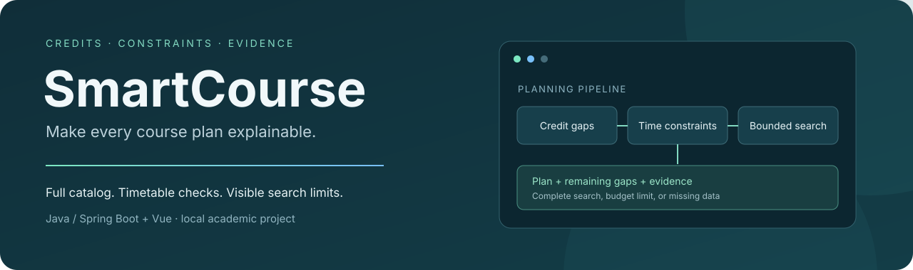
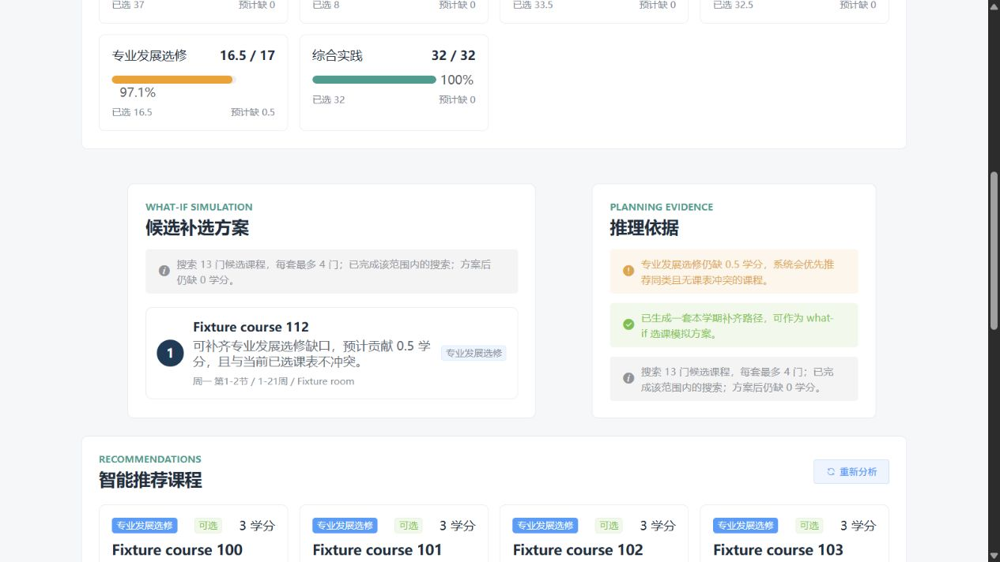

<p align="center"></p>

# SmartCourse

**Course management with explainable, constraint-aware academic planning.**

[](https://github.com/LE0-Lin/SWUSmartCourseManagement/actions/workflows/ci.yml)
[](SmartCourse-Server/pom.xml)
[](SmartCourse-App/package.json)
[](LICENSE)

[Try the advisor locally](#try-the-advisor-without-a-database-server) · [Demo gallery](docs/demo.md) · [Planning design](docs/planning.md) · [Development timeline](docs/development-timeline.md) · [Upstream credits](docs/UPSTREAM.md)

A Java/Spring Boot and Vue academic project with student, teacher, and administrator applications. It extends the [OnlineEdu](https://github.com/snwjas/OnlineEdu) codebase with week-aware timetables, weighted grades, curriculum credit accounting, and a deterministic course-path planner. The advisor runs from explicit data and constraints, without a model API.

## See the planner work



*Actual Vue component rendered with synthetic JSON generated by JDBC integration tests. This is a reproducible regression scenario, not a deployed student record.*

The fixture has a **0.5-credit gap**. Twelve popular courses offer 3 credits each; the thirteenth offers exactly 0.5. Recommendation cards still display twelve courses, while the planner searches the full eligible catalog and finds the exact fit.

| Engineering problem | Implemented behavior |
| --- | --- |
| Extra credits in one category hide a shortage in another | Calculate completion within each requirement bucket before aggregating. |
| A good course is outside the visible recommendation list | Keep display limits separate from planning candidates. |
| Courses fit separately but conflict when selected together | Check existing and proposed timetable intervals, including teaching weeks. |
| Large candidate sets make search expensive | Limit each plan to four courses and each search to 100,000 visited states; report unfinished searches. |
| A missing timetable is mistaken for a conflict-free course | Exclude incomplete candidates; withhold the plan when selected-course evidence is missing. |
| Search makes repeated database calls | Batch timetable reads before entering a pure Java search module. |

## Try the advisor without a database server

Requirements: JDK 8 or 17, Maven, Node.js, npm, and Python 3. The tests use an isolated H2 database; MySQL, Redis, cloud credentials, and a login are unnecessary for this preview.

```sh
cd SmartCourse-Server
mvn verify
cd ../SmartCourse-App
npm ci --ignore-scripts --no-audit --no-fund
cd ..
python scripts/preview_advisor.py
```

On Windows, use `py -3.12 scripts/preview_advisor.py` if `python` is not configured. Open **http://127.0.0.1:19531/** and switch between:

- **Exact fit beyond twelve cards** — the full catalog contains a better plan.
- **Missing candidate timetable** — incomplete candidates are identified and excluded.
- **Missing selected timetable** — the planner withholds a conflict-free claim.
- **Search limit** — a partial search returns its best observed plan with an explicit warning.

The preview compiles the repository's actual advisor component and serves test-generated fixtures on localhost. It performs no enrollment or database writes.

## Verify changes

```sh
cd SmartCourse-Server
mvn verify
```

The suite has **21 tests**, including a comparison against a separately implemented exhaustive subset enumerator on **100 seeded catalogs**, and JDBC integration tests for the full-catalog regression, credit buckets, incomplete data, and the search budget. These are engineering checks for the modeled cases, not evidence of deployment or general planning accuracy.

The CI workflow runs backend verification on Java 8 and 17 and builds the student frontend. For a local production frontend build, this legacy Webpack 4 stack needs `NODE_OPTIONS=--openssl-legacy-provider` on modern Node.js; see [setup notes](docs/setup.md).

## Application structure

| Directory | Responsibility |
| --- | --- |
| [SmartCourse-Server](SmartCourse-Server) | Spring Boot APIs, SQL persistence, grades, timetable validation, and advisor integration. |
| [SmartCourse-App](SmartCourse-App) | Student course browsing, timetable, grades, and what-if planning. |
| [SmartCourse-Teacher](SmartCourse-Teacher) | Teacher course, timetable, and grade workflows. |
| [SmartCourse-Admin](SmartCourse-Admin) | Course administration and graduation-risk overview. |
| [SmartCourse-Portal](SmartCourse-Portal) | Local demonstration entry point for the three roles. |

For the full application, see [setup and runtime notes](docs/setup.md). Its local MySQL initialization seeds and updates demonstration data; use a dedicated demo database.

## Current scope

The built-in requirements model one curriculum. The planner checks category credits and inclusive weekday/section/week intervals, with the limits reported in each response. It does not model prerequisites, enrollment capacity, multiple academic terms, or institution-wide degree rules. The what-if plan does not enroll a student or guarantee graduation.

The application retains a legacy Spring Boot 2/Vue 2 dependency stack. Dependency modernization and broader deployment/authentication tests remain work to do; the fixture preview and isolated tests provide a small starting point for contributors.

## Provenance and license

The original platform and frontend template credits are preserved. Read [UPSTREAM.md](docs/UPSTREAM.md) for the source projects and the distinction between inherited platform code and SmartCourse extensions. Code is distributed under [MIT](LICENSE), with existing component notices retained. University photographs and logos have separate source notices in [PHOTO_SOURCES.md](SmartCourse-Portal/PHOTO_SOURCES.md).
