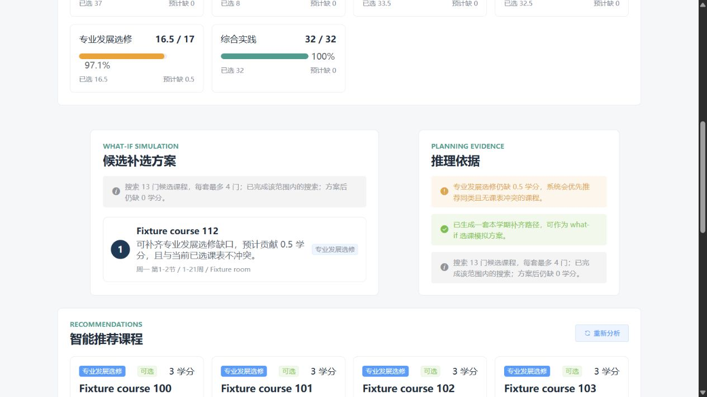
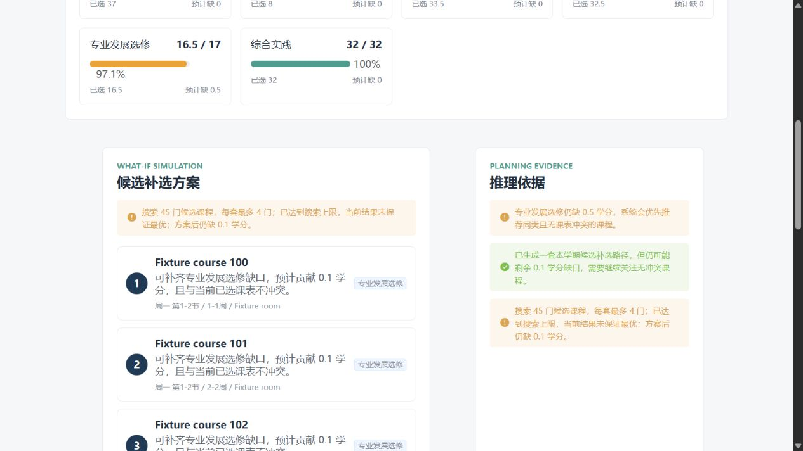

# Advisor demo gallery

All screenshots show the actual student advisor component using synthetic JSON exported by the JDBC integration tests. They do not show real students or a hosted deployment.

Follow the [local preview instructions](setup.md) to reproduce these states. The fixture JSON and generated HTML live under ignored `target/` and `build/` directories.

## Full catalog, exact fit

The visible recommendation list contains twelve popular three-credit courses. The full candidate pool also contains a half-credit course. The planner finds that thirteenth course and closes the half-credit gap without excess credits.

[Dashboard overview](assets/advisor-full-catalog.jpg)

## Missing candidate timetable

The service excludes a course whose timetable is missing. The UI explains the incomplete data instead of presenting that course as conflict-free, and disables its diagnosis action.

## Search budget reached

Forty-five synthetic candidates exercise the bounded search. The UI presents the best observed four-course plan, its remaining gap, and a visible warning that the search stopped at its budget.

## Browser checks

The four preview states were checked in a browser, including withholding a plan when a selected timetable is missing. At a 390 px viewport, document content width was also 390 px. This is a focused component check, not a full multi-role end-to-end test.
