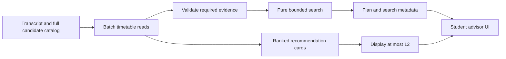

# Constraint-aware course planning

## Data flow

The display list never supplies the planner's candidate pool. [SmartAdvisorService](../SmartCourse-Server/src/main/java/xyz/refrain/onlineedu/service/SmartAdvisorService.java) loads the candidate catalog and batches timetable rows. [CoursePathPlanner](../SmartCourse-Server/src/main/java/xyz/refrain/onlineedu/service/planning/CoursePathPlanner.java) receives immutable course values and occupied slots; it has no JDBC or Spring dependency and performs no enrollment.

## Constraints and objective

The search considers at most four additional courses. Each course needs positive known credits and a valid timetable. Courses must not overlap an occupied slot or another proposed course. A slot overlaps when its weekday matches and both its inclusive section interval and inclusive teaching-week interval intersect. Odd/even week patterns and academic terms are outside this model.

Compare feasible plans lexicographically:

1. Minimize remaining credits, calculated independently in every requirement bucket.
2. Minimize credits exceeding those bucket gaps.
3. Minimize the number of selected courses.
4. Prefer lower total candidate rank.
5. Break equal-rank ties with sorted course IDs.

The search module uses `BigDecimal` for objective arithmetic. The adapter's curriculum and credit summaries retain the existing half-credit dataset model. Ranking is a heuristic preference, not a probability of success.

The empty plan is valid. Once a bucket is fulfilled, adding another course to that bucket cannot improve this objective, so that branch is skipped. Once all gaps are filled, extensions cannot improve excess or course count. Other subsets remain eligible for search.

## Bounded work and evidence

The search visits at most **100,000 states**. If another state would be needed, it returns the best observed plan with `searchComplete: false`. It does not claim optimality after a cutoff. A completed search establishes the objective minimum only inside the modeled catalog, data, and four-course scope.

For a nonempty selected set and candidate set, a student dashboard uses two timetable queries: one for selected courses and one for all candidates. There are no database calls inside the search. Empty sets skip their corresponding query. Admin overview currently repeats this per student; cross-student batching is future work.

The dashboard retains `pathPlan` and `recommendations` and adds a `planning` object:

| Field | Meaning |
| --- | --- |
| `status` | `COMPLETE`, `SEARCH_LIMIT`, `INCOMPLETE_DATA`, `INSUFFICIENT_SCHEDULES`, or `INSUFFICIENT_CREDITS`. |
| `searchComplete` | Search finished for the eligible known-data pool and the selected-course evidence permits a search. |
| `inputComplete` | Selected credit/category and timetable checks passed, with no gap-relevant candidate excluded for missing credit/timetable evidence. This is not general database validation. |
| `candidateCount` | Eligible courses actually considered by the search. |
| `excludedCourseIds` | Gap-relevant candidates excluded for missing or invalid credit/timetable data. |
| `maxCourses`, `stateLimit`, `exploredStates` | The scope and work budget used for this request. |
| `remainingCredits`, `excessCredits` | Objective values for the returned plan. |
| `message` | Human-readable scope, incomplete-data, cutoff, and remaining-gap explanation. |

`COMPLETE` means the search finished; a positive remaining gap can still be the best achievable result. When selected credit/category evidence or a selected timetable is incomplete, the service returns no plan and marks the relevant status. A missing candidate timetable is excluded rather than interpreted as “no conflict.”

## Reproduce the regressions

Run `mvn verify` in `SmartCourse-Server`. [Planner tests](../SmartCourse-Server/src/test/java/xyz/refrain/onlineedu/service/planning/CoursePathPlannerTest.java) compare the search with an integer-credit bit-mask enumerator on 100 seeded eight-course catalogs. They also cover inclusive intervals, decimal arithmetic, stable ties, occupied slots, the four-course cap, and budget exhaustion.

[JDBC tests](../SmartCourse-Server/src/test/java/xyz/refrain/onlineedu/service/SmartAdvisorServiceTest.java) execute the actual SQL against fresh H2 schemas. They produce four fixture files under `SmartCourse-Server/target/demo/` for the browser preview. H2 tests do not substitute for MySQL deployment, authentication, concurrency, or end-to-end enrollment tests.

The search-limit fixture places 45 synthetic courses in disjoint weekday/week slots to exercise the state budget. It is an algorithm stress fixture, not a measured production workload. The current slot model validates interval ordering and positive section numbers, not an institution's maximum daily section count.
